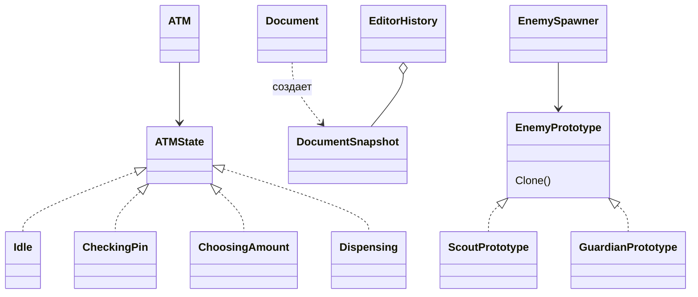
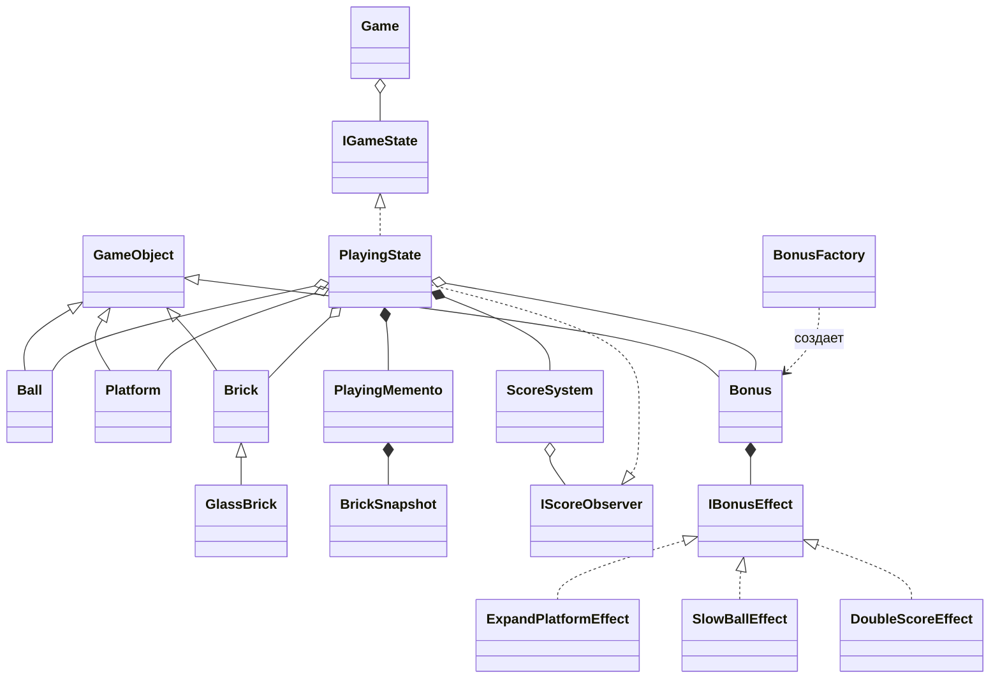
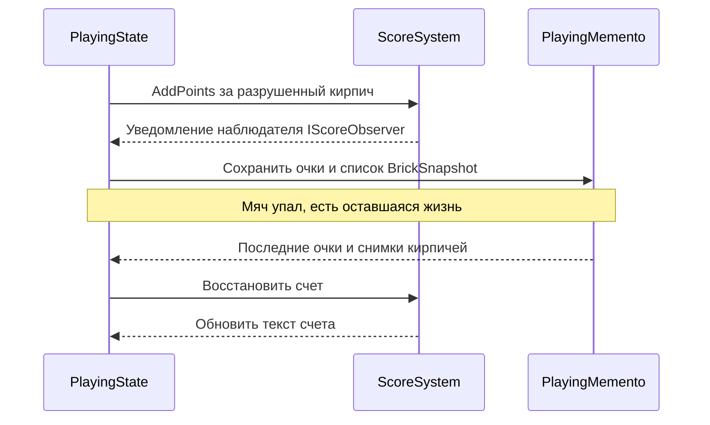
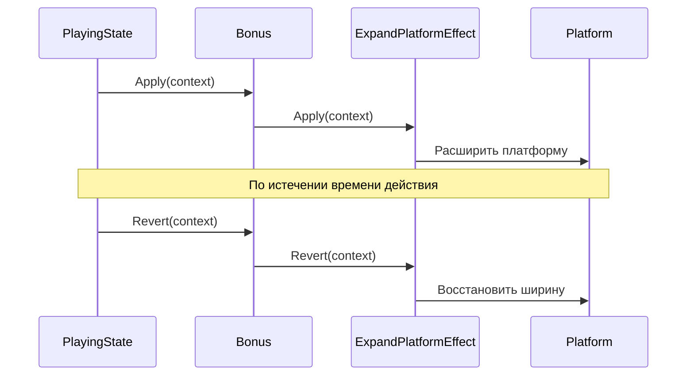
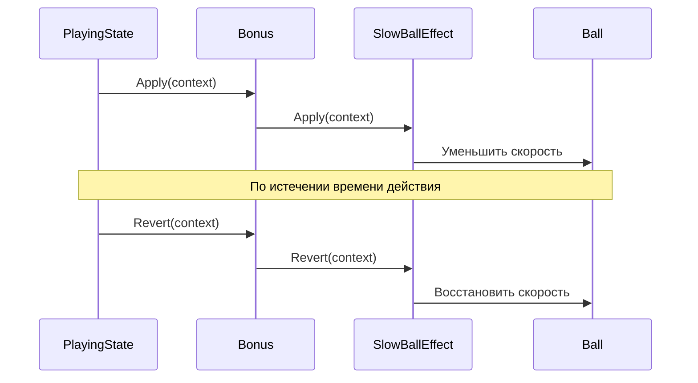
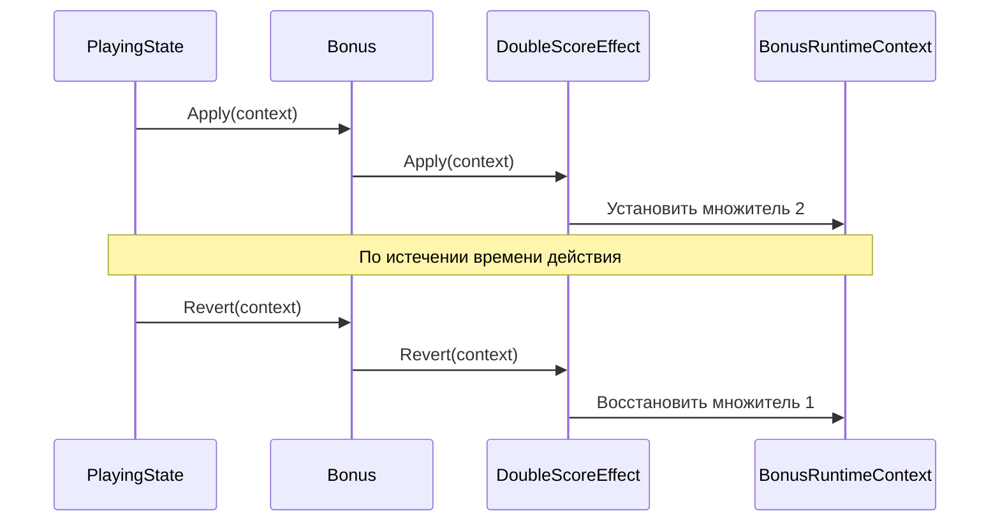

# ДЗ 9. Паттерны и UML

## Состояние, снимок, прототип

- **State.** Банкомат делегирует обработку событий состоянию `Idle`, `CheckingPin`, `ChoosingAmount` или `Dispensing`. Карта, верный PIN, отмена и подтверждение суммы переключают состояния. Отмена возвращает карту в состояниях до выдачи. Ошибка выдачи передаётся обработчику транзакции, который отменяет списание.
- **Memento.** Перед редактированием графический редактор сохраняет неизменяемый снимок документа в стеке Undo и очищает Redo. Undo переносит текущий снимок в Redo и применяет верхний элемент Undo. Redo выполняет обратную операцию. Снимок содержит данные документа и создаётся самим документом.
- **Prototype.** Таблица прототипов хранит настроенные образцы врагов. Фабрика вызывает виртуальный `Clone` у образца нужного типа, задаёт позицию экземпляру и добавляет его на карту. Изменяемые данные вроде здоровья копируются для экземпляра.

## Arkanoid

| Событие | Участники | Результат |
| --- | --- | --- |
| Начисление | `PlayingState → ScoreSystem → IScoreObserver` | Изменяется счёт, наблюдатель обновляет текст интерфейса. |
| Снимок | `PlayingState → PlayingMemento → BrickSnapshot` | Сохраняются очки и состояние кирпичей, которые можно восстановить после потери жизни. |
| Выпадение | `PlayingState → BonusFactory → Bonus` | При разрушении кирпича вероятность появления бонуса 10%, длительность эффекта от 5 до 10 секунд. |
| Широкая платформа | `Bonus → ExpandPlatformEffect → Platform` | Размер платформы увеличивается и затем возвращается к исходному. |
| Медленный мяч | `Bonus → SlowBallEffect → Ball` | Скорость мяча временно снижается. |
| Удвоение очков | `Bonus → DoubleScoreEffect → BonusRuntimeContext` | Временно увеличивается множитель набранных очков. |

## Начисление очков и восстановление снимка

## Бонус широкой платформы

## Бонус медленного мяча

## Бонус удвоения очков

